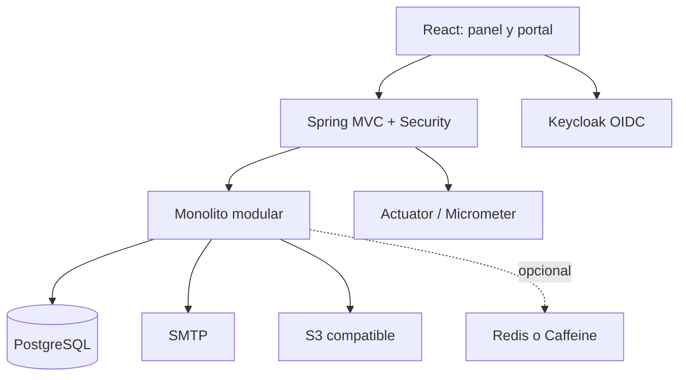

# Arquitectura

Monolito modular Spring Boot, desplegable único. Spring Modulith para verificar dependencias y eventos. Arquitectura hexagonal pragmática en bookings y availability: dominio independiente, aplicación (casos de uso, puertos, transacciones), adaptadores (JPA, REST, correo). CRUD simples con separación razonable, no capas ceremoniales.



## Stack propuesto
| Área | Tecnología |
|---|---|
| Backend | Java 21 LTS, Spring Boot, MVC, Spring Data JPA, Hibernate, Jakarta Validation, Maven |
| Modularidad | Spring Modulith |
| Identidad | Spring Security, Keycloak OIDC |
| Datos | PostgreSQL, Flyway |
| Caché | Caffeine o Redis, opcional y posterior |
| API | Springdoc OpenAPI |
| Archivos | S3 compatible / MinIO |
| Correo | Spring Mail, Mailpit |
| Frontend | React, Vite, TypeScript, Tailwind, shadcn/ui, TanStack Query, React Hook Form, Zod, FullCalendar |
| Testing | JUnit, Mockito, Testcontainers, k6 |
| DevOps | Docker Compose, GitHub Actions, Nginx |
| Observabilidad | Actuator, Micrometer, Prometheus, Grafana |

Versiones compatibles por fijar en Sprint 00. No incorporar caché como fuente de verdad de disponibilidad.

## Repositorio futuro
```text
slotera/
  apps/api/  (pom.xml, mvnw, mvnw.cmd, src/main/java/com/slotera, src/main/resources, src/test)
  apps/web/  (src, public, package.json)
  infrastructure/  (docker, nginx, keycloak, prometheus, grafana)
  docs/  (product, architecture, database, api, security, testing, sprints, adr, design, learning, operations)
  scripts/
  .github/workflows/
  compose.yaml
  .env.example
  .gitignore
  AGENTS.md
  CONTRIBUTING.md
  README.md
```

## Decisiones
Ver ADR. No microservicios ni Kubernetes para MVP. API versionada, errores RFC 9457, timestamps UTC, dinero BigDecimal, UUID. Eventos confiables tras commit; evitar acoplar correo a transacción de reserva.
