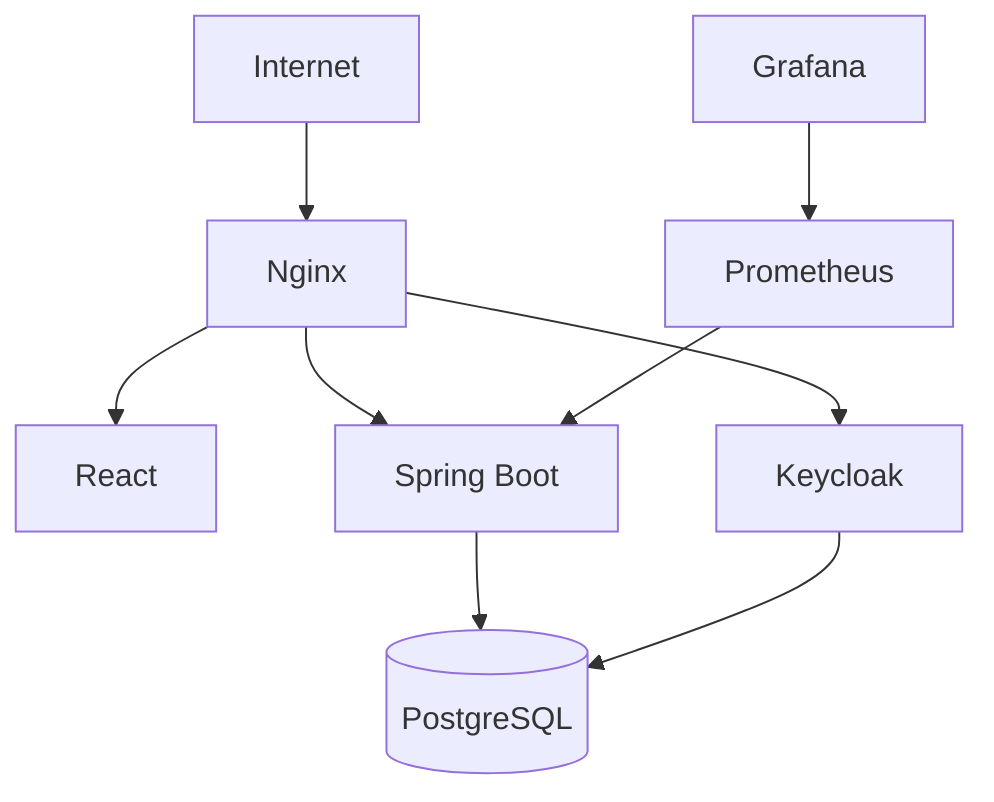

# Despliegue

Local: Docker Compose con PostgreSQL, Keycloak, Mailpit; MinIO y observabilidad cuando proceda. Perfiles dev/test/prod. Producción demo: servidor único, Nginx HTTPS → web y API; Keycloak protegido y PostgreSQL sin exposición pública. Prometheus recopila Actuator/Micrometer; Grafana restringido. Sin Kubernetes.

CI PR: compilar Java, unitarias, integración, análisis calidad/seguridad, frontend, imágenes Docker. Merge main: publicar imágenes versionadas, desplegar staging, smoke tests; promover demo tras revisión. Si falla, no promover; rollback compatible con migraciones. Configuración real del proveedor y secretos pendiente.
