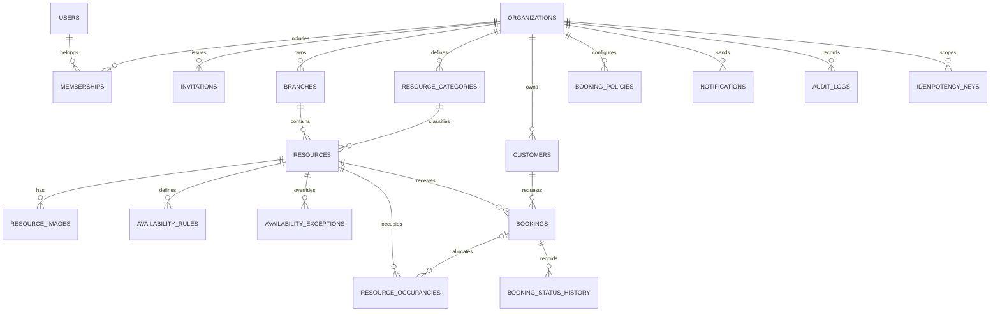

# Modelo entidad-relación conceptual

Modelo preliminar. Toda entidad de negocio requiere organización coherente; usar claves foráneas compuestas cuando corresponda. Una ocupación puede representar mantenimiento sin reserva. El historial de reprogramación debe conservar intervalos anteriores. El diagrama no constituye DDL ejecutable.
