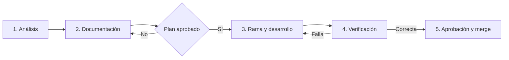

# Metodología de ejecución de sprints

Estado: propuesta para Slotera. Aplica a desarrolladores y agentes. Conserva las cinco fases de la guía Torcly, adaptadas a Java/Spring Boot.



## Organización documental
Los actuales `docs/sprints/SPRINT-XX.md` conservan el backlog y la estimación del roadmap; no reemplazarlos ni duplicar sus requisitos. Para cada sprint ejecutado crear `docs/sprints/sprint-XX-nombre/` con los cuatro archivos de `templates/`. Enlazar el documento de roadmap desde el README del sprint y viceversa. El estado operativo se registra en el README de ejecución y el acta; actualizar el estado del roadmap al cerrar. No crear actas aprobadas de sprints futuros.

## Fase 1 — Análisis
**Entrada:** sprint identificado y documentación disponible.
1. Inspeccionar `git status --short`, rama actual, historial reciente, estructura, scripts, dependencias y estado del sprint previo. No sobrescribir cambios ajenos ni cambiar de rama con cambios incompatibles.
2. Leer PRODUCT, REQUIREMENTS, FEATURES, BUSINESS_RULES, FLOWS, ROADMAP, ADR y documentación de módulos afectados.
3. Identificar objetivo, actores, flujo normal, alternativo y errores; historias de usuario con criterios GIVEN/WHEN/THEN e IDs trazables.
4. Evaluar dependencias, permisos, contratos, modelo de datos, migraciones, aislamiento, concurrencia, UI, infraestructura, riesgos y regresiones.
5. Distinguir requisitos confirmados, supuestos y decisiones pendientes. No iniciar si una decisión bloqueante sigue abierta.
**Salida:** alcance cerrado propuesto, impactos y cuestiones pendientes.

## Fase 2 — Documentación formal previa
Crear `README.md`, `implementation-plan.md`, `acceptance-and-test-plan.md` y `approval.md` (estado pendiente). Detallar archivos previstos, orden de cambios, contratos, migraciones, reversión, pruebas y pasos de aprendizaje. Registrar criterios y casos negativos antes del código. No presentar resultados ficticios. Los archivos pueden prepararse como borradores sin modificar código; incorporar al branch del sprint tras aprobación. Si hay cambios locales, preservar su contenido antes de cambiar de rama.

Presentar al usuario objetivo, alcance/exclusiones, riesgos, alternativas, archivos, comandos, pruebas, decisiones y estimación. **Esperar aprobación explícita del plan**; guardar fecha, referencia y alcance aprobado. Si el plan cambia sustancialmente, volver a esta puerta. No confundir aprobación del plan con aprobación de merge.

## Fase 3 — Git e implementación aislada
Sprint 00 conserva su base y PR hacia `main`. Tras verificar su cierre, crear `develop` desde `main`. Para los siguientes sprints la base y destino del PR será `develop`. La promoción posterior a `main` requiere autorización específica.

```bash
git status --short
git fetch origin
git switch develop
git pull --ff-only origin develop
git switch -c sprint/XX-nombre
```
Usar rama existente si corresponde y comprobar su base. Si diverge develop o hay conflictos, detener y acordar resolución. No resetear, limpiar ni usar force push.

Implementar en incrementos pequeños conforme al plan: migraciones, dominio, aplicación, adaptadores, contratos, UI y tests según dependencias reales. Revisar módulos y componentes existentes antes de crear nuevos. Actualizar README de módulo y ADR cuando corresponda. Explicar conceptos y dejar ejercicios acordados. Registrar desviaciones en el plan; pedir nueva aprobación si cambia el alcance o una decisión crítica.

Commits atómicos: `feat(bookings): impedir reservas superpuestas`, `test(availability): cubrir intervalos consecutivos`, `docs(sprint-06): registrar criterios de aceptación`. Usar tipos feat, fix, docs, refactor, test, chore, ci. Revisar `git diff` y `git diff --cached`; añadir archivos específicos, no secretos ni artefactos ajenos. Push de rama propia cuando esté autorizado.

## Fase 4 — Verificación y Definition of Done
Ejecutar comandos reales de compilación, lint, pruebas unitarias/integración y build definidos por el repositorio; ver [estándares](ENGINEERING_STANDARDS.md). Verificar migraciones sobre PostgreSQL real cuando aplique, pruebas de seguridad y concurrencia, flujos manuales y responsive. Ejecutar CI del commit final y revisar diferencias, logs y riesgos. Registrar comando, directorio, fecha, commit, código de salida, resultado, evidencia y entorno; ocultar secretos.

Estados por caso: `PENDING`, `PASS`, `FAIL`, `BLOCKED`, `NOT_APPLICABLE` (justificado). No convertir faltas de acceso en PASS. Corregir fallos y repetir pruebas afectadas y regresiones. Actualizar la matriz de aceptación con resultado observado.

### DoD obligatorio
- [ ] Todos los criterios de aceptación aplicables pasan; sin fallos ni bloqueos pendientes.
- [ ] API compila y pruebas unitarias/integración pasan; frontend typecheck, lint, tests y build pasan cuando aplican.
- [ ] Migraciones y restricciones verificadas; aislamiento, permisos, idempotencia y concurrencia probados según impacto.
- [ ] Flujos manuales completos; UI sin errores ni warnings de React, responsive 375/768/1280 px y accesibilidad básica si aplica.
- [ ] Contratos, documentación de módulos, ADR y matriz actualizados.
- [ ] Sin secretos, cambios ajenos ni dependencias no aprobadas; CI verde para el commit candidato.
- [ ] `approval.md` contiene evidencia y riesgos residuales; PR revisado y aprobación humana registrada antes del merge.

## Fase 5 — Aprobación, fusión y cierre
1. Completar `approval.md` con evidencia y estado `READY_FOR_REVIEW` solo si DoD técnico está satisfecho. Presentar resumen de entregables, comandos, resultados, cambios, riesgos y aprendizaje.
2. Abrir PR de la rama a `develop` (Sprint 00 a `main`), incluir enlaces a los documentos, riesgos y evidencia. Revisar CI, comentarios y diff final. Solicitar aprobación humana explícita y autorización de merge; no autoaprobar.
3. Registrar aprobación con identidad, fecha, referencia y commit revisado. Si se modifica código tras aprobación, invalidar aprobación y revalidar. La actualización exclusivamente administrativa del acta debe ser trazable y respetar las políticas del PR.
4. Fusionar solo con aprobación y checks requeridos. Si no hay permisos, dejar PR listo y pedir al usuario ejecutar el merge. No afirmar que se fusionó hasta verificarlo.
5. Actualizar la rama destino local, confirmar merge por Git/PR y registrar SHA y referencia de PR. Actualizar acta y roadmap mediante el mecanismo autorizado. Eliminar rama propia solo tras verificar merge y si corresponde; no usar `-D` por defecto.
6. Marcar `CLOSED` tras verificar fusión y registro final. Después de Sprint 00 crear `develop` desde `main`; los siguientes sprints parten de `develop` actualizado. No comenzar otro sprint sin autorización.

## Estados y recuperación
`PLANNED → ANALYSIS → PLAN_REVIEW → APPROVED → IN_PROGRESS → VERIFYING → READY_FOR_REVIEW → MERGE_APPROVED → CLOSED`. `BLOCKED` se puede usar en cualquier fase con causa y acción siguiente. Al retomar, comprobar evidencia y estado real. Si una fase falla, retornar a la fase pertinente sin perder el historial.
