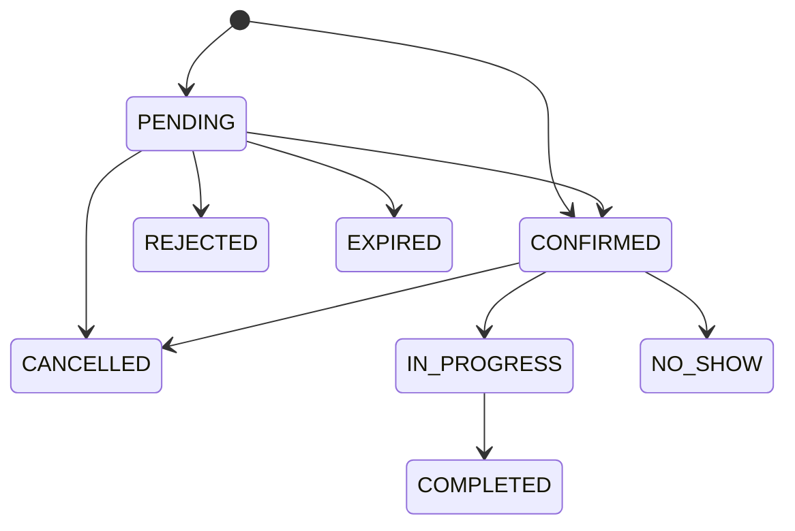

# Flujos operativos

## Alta de empresa
Registro y verificación en proveedor de identidad → crear organización y membresía OWNER → configurar sede → recurso → horarios → publicar portal.

## Reserva pública
Abrir `/book/arena-sports` → elegir recurso → consultar disponibilidad → elegir intervalo → ingresar datos y aceptar condiciones → verificar correo según política → crear solicitud atómica → mostrar código y enviar enlace seguro. El momento exacto de verificación y bloqueo debe decidirse antes del Sprint 08.

## Reserva administrativa
Seleccionar organización y recurso → buscar cliente → elegir intervalo → validar política y permisos → calcular precio → crear reserva → confirmar o dejar pendiente → notificar.

## Estados (propuesta)

Confirmación automática entra en CONFIRMED. Reprogramación conserva el estado permitido y registra historial; sustituye ocupación dentro de la misma transacción. Definir permisos y ventanas de check-in/no-show antes de implementar. Rechazo/expiración/cancelación liberan ocupación. Conservar historial de intervalos completados.

## Bloqueos
Administrador crea mantenimiento → validar conflicto con reservas existentes → registrar ocupación de bloqueo. No cancelar reservas existentes silenciosamente. Si hay conflicto, devolver error y permitir resolución explícita.

## Cancelación
Validar actor, organización, estado y política → registrar motivo → liberar ocupación → auditar → notificar tras commit.
